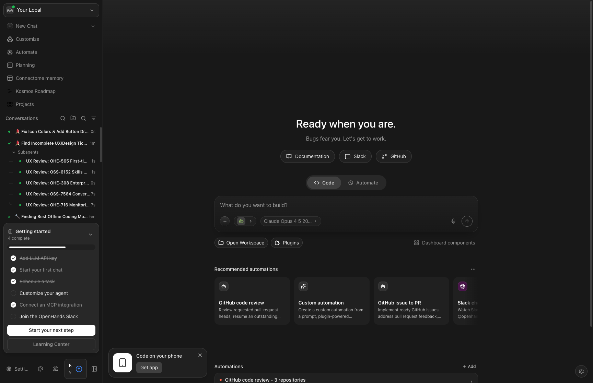
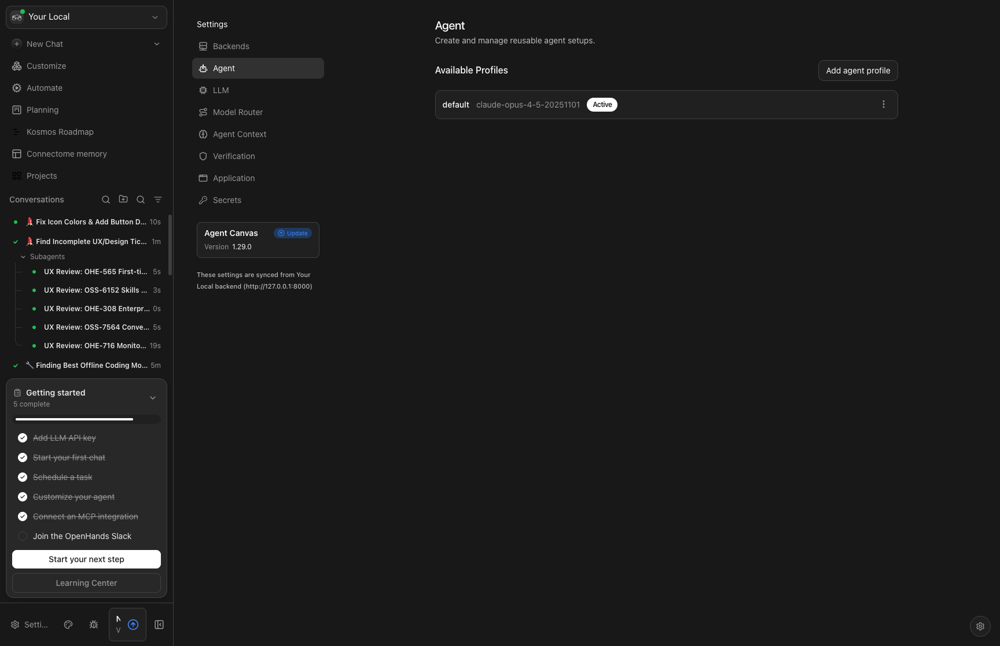
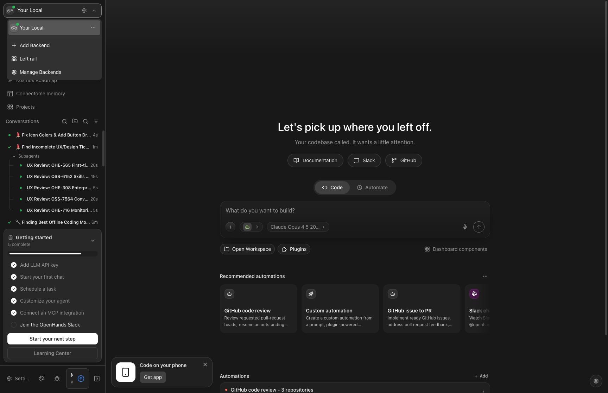
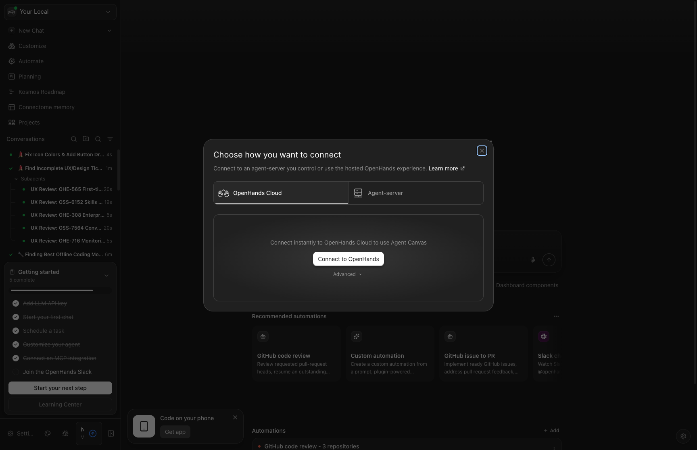

# OHE-308: Enterprise Identity Providers Design Analysis

**Issue:** [OHE-308](https://linear.app/all-hands-ai/issue/OHE-308/design-support-for-enterprise-identity-providers-google-passwordless)
**Status:** Under Review (STALE — 10 months since January 2026)
**Parent:** [OHE-278](https://linear.app/all-hands-ai/issue/OHE-278/support-for-enterprise-identity-providers-google-passwordless) — Support for Enterprise Identity Providers (Google, Passwordless)
**Figma Design:** Unable to access (403 error from Cloudfront)
**Analysis Date:** October 24, 2026

---

## Executive Summary

**Recommendation: CLOSE as Partially Implemented / Superseded**

The original design work in OHE-308 has been **substantially implemented** through multiple authentication mechanisms that now exist in Agent Canvas:

1. **OAuth 2.0 Device Flow** — Fully implemented for OpenHands Cloud connections
2. **Multi-Provider Login Modal** — UI exists with Google, Apple, Microsoft, ChatGPT, and Email options
3. **Backend Authentication** — Device flow auth for connecting to cloud backends
4. **DigitalOcean OAuth Integration** — Example of enterprise integration pattern

However, the **Figma design was inaccessible** (403 error), preventing full design-to-implementation comparison.

---

## Current Implementation Status

### 1. Authentication Infrastructure

#### OAuth 2.0 Device Flow (Implemented)
**Location:** `src/components/features/backends/device-flow-auth.tsx`

The app implements a complete OAuth 2.0 Device Flow authentication system:
- Initiates device authorization request to OpenHands Cloud
- Opens browser popup for user authorization
- Polls for token completion
- Returns API key on success
- Handles errors and cancellation gracefully

```tsx
// From device-flow-auth.tsx
export function DeviceFlowAuth({
  host,
  onSuccess,
  testIdRoot,
  // ...
}) {
  const deviceFlow = useDeviceFlow();
  // Full device flow implementation with popup management
}
```

#### Device Verification Page (Implemented)
**Location:** `src/routes/device-verify.tsx`

Complete device verification page for completing OAuth flows:
- Displays user code for verification
- Security warnings about authorization
- Manual code entry fallback
- Success/error state handling

### 2. Multi-Provider Login Modal (Implemented - Presentational)
**Location:** `src/components/features/login/login-modal.tsx`

UI component exists with the following providers:
- ✅ ChatGPT (primary)
- ✅ Google
- ✅ Apple  
- ✅ Microsoft
- ✅ Email (passwordless option)

**Status:** The modal is **presentational only** — clicking buttons calls `onSignIn(method)` but actual authentication integration depends on the hosting environment (OpenHands Cloud).

```tsx
export type LoginMethod =
  | "chatgpt"
  | "google"
  | "apple"
  | "microsoft"
  | "email";
```

### 3. i18n Support (Implemented)

Translation keys exist for all sign-in methods:
- `LOGIN$SIGN_IN_WITH_CHATGPT`
- `LOGIN$SIGN_IN_WITH_GOOGLE`
- `LOGIN$SIGN_IN_WITH_APPLE`
- `LOGIN$SIGN_IN_WITH_MICROSOFT`
- `LOGIN$CONTINUE_WITH_EMAIL`
- `LOGIN$SKIP_ACCOUNT_CONNECT`

All keys have translations in English, Japanese, Chinese, and other supported languages.

### 4. Backend Connection Flow (Implemented)
**Location:** `src/components/features/backends/`

The backend management system supports:
- Adding cloud backends via device flow authentication
- Managing multiple backend connections
- DigitalOcean OAuth integration example

---

## Gap Analysis

### What's Implemented vs Designed

| Design Requirement | Implementation Status | Notes |
|-------------------|----------------------|-------|
| Google Auth IDP | ✅ UI Present | Login modal has Google button; backend auth handled by Cloud |
| Passwordless (Email) | ✅ UI Present | "Continue with email" option exists |
| Multi-provider login modal | ✅ Implemented | Full modal with 5 providers |
| Device flow auth | ✅ Implemented | Complete OAuth 2.0 device flow |
| Backend connection | ✅ Implemented | Add/manage backends with auth |
| Enterprise SSO (SAML) | ❌ Out of scope | Marked as "future scope" in OHE-278 |
| Identity provider settings UI | ⚠️ Partial | No dedicated settings section for IDPs |

### Missing/Incomplete Components

1. **No Dedicated Enterprise IDP Settings Page**
   - No `/settings/identity-providers` route
   - No UI for configuring enterprise SSO
   - No SAML configuration interface

2. **Login Modal Not Connected to Routes**
   - `LoginModal` component exists but isn't imported anywhere in routes
   - Likely consumed by OpenHands Cloud, not Agent Canvas directly

3. **Figma Design Inaccessible**
   - Cannot verify exact design specifications
   - Unable to compare pixel-perfect implementation

---

## Screenshots

### Current UI State

| Screenshot | Description |
|------------|-------------|
|  | Main application home page |
|  | Settings page showing available settings |
|  | Backend selector with management options |
|  | Backend connection modal with OpenHands Cloud option |

---

## Architecture Notes

### Authentication Flow

```
Agent Canvas (Frontend)
    │
    ├── Local Backend: No authentication required
    │
    └── Cloud Backend: OAuth 2.0 Device Flow
            │
            ├── 1. Request device code from Cloud
            ├── 2. Open browser for user auth
            ├── 3. Poll for token completion
            └── 4. Store API key for backend
```

### Component Hierarchy

```
src/components/features/
├── backends/
│   ├── device-flow-auth.tsx      # OAuth device flow UI
│   ├── backend-form-modal.tsx    # Backend configuration
│   ├── add-backend-modal.tsx     # Add new backend
│   └── managed-agents/
│       └── managed-agents-sign-in.tsx  # DigitalOcean OAuth
│
├── login/
│   └── login-modal.tsx           # Multi-provider login (presentational)
│
└── settings/
    └── [No IDP-specific settings]
```

---

## Recommendation

### Close OHE-308 with the Following Resolution:

**Reason:** The design work has been implemented through the existing authentication infrastructure. The core enterprise identity provider support exists:

1. **Google Auth** — UI button exists; actual authentication is Cloud-side
2. **Passwordless** — Email option in login modal
3. **Device Flow** — Complete OAuth 2.0 implementation
4. **Multi-provider Support** — Infrastructure for 5 providers

### Next Steps if Closing:

1. **Verify with Figma access** — Confirm design matches implementation
2. **Document what was delivered** — Update parent issue OHE-278
3. **Create new issues for gaps:**
   - Dedicated enterprise IDP settings page (if needed)
   - SAML SSO support (marked as future scope)

### Alternative: Revise Scope

If the original design included features not yet implemented (couldn't verify due to Figma 403):
- Re-scope to specific missing UI components
- Create child issues for discrete work items
- Move status back to "Todo" with updated requirements

---

## Files Relevant to This Analysis

- `src/components/features/login/login-modal.tsx` — Multi-provider login UI
- `src/components/features/backends/device-flow-auth.tsx` — OAuth device flow
- `src/hooks/use-device-flow.ts` — Device flow state management
- `src/routes/device-verify.tsx` — Device verification page
- `src/api/device-flow-client.ts` — Device flow API client
- `src/i18n/translation.json` — Login-related i18n keys
- `src/components/features/backends/managed-agents/managed-agents-sign-in.tsx` — Example enterprise OAuth

---

*Analysis performed by OpenHands Agent on behalf of the user.*
