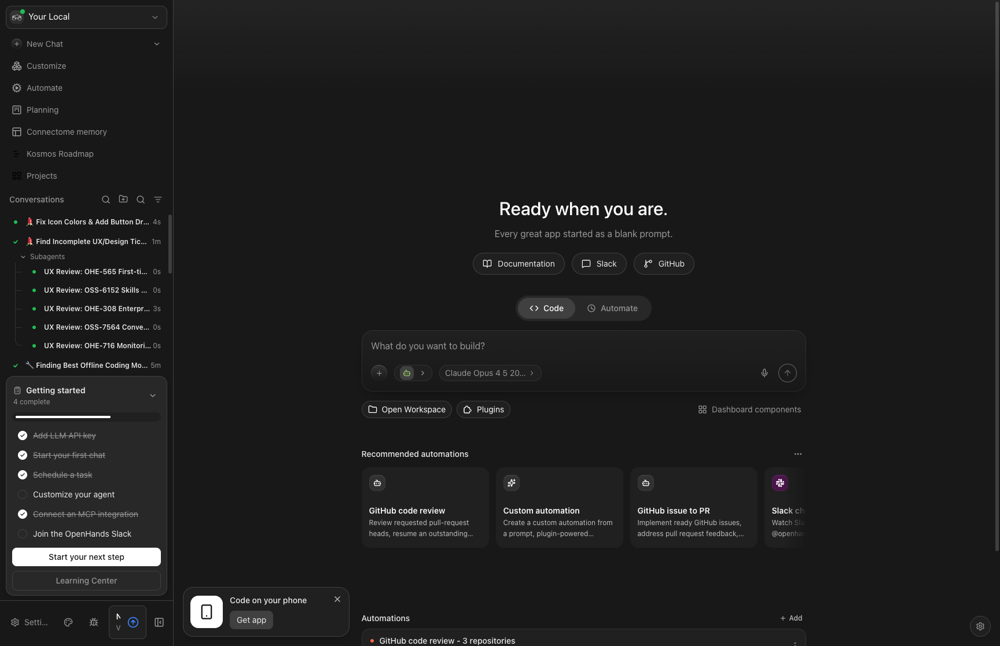

# OHE-565 Analysis: First-time Repo Onboarding Design

**Issue:** OHE-565 - [Design] First-time repo onboarding  
**Status:** In Progress (STALE - 6 months since Apr 2026)  
**Parent:** OHE-563 (now **CANCELED** as of Oct 20, 2026)  
**Figma:** https://figma.com/design/iM5UBG1lnpg2sgE3cFnF1P/OpenHands-Product-Designs--Paul-Bloch-?node-id=14533-28086  
**Analysis Date:** October 24, 2026

---

## 1. Original Design Requirements (OHE-565 + Parent OHE-563)

Based on the Linear issue descriptions and comments, the original design addressed:

### 1.1 Core Problem Statement (from OHE-563)
New developers starting with OpenHands faced challenges:
- Unfamiliar with microagents and `repo.md`/AGENTS.md files
- Unknown remote runtime configurations and base image selection
- Multi-repo/cross-repo awareness complexity
- Runtime workspace setup time impacting productivity

### 1.2 Original Design Goals
1. **Repo onboarding workflow** - Help users set up repos with appropriate dependencies and context
2. **AGENTS.md generation** - Proactively create agent configuration files for new repos
3. **"Learn this repo" functionality** - Auto-generate repo context
4. **Plugin integration** - Use onboarding plugin to generate artifacts (AGENTS.md, setup scripts, PR review workflows)

### 1.3 April 2026 Design Direction (from comments)
The most recent design direction proposed:
- Detect repos needing onboarding when user selects repo for conversation
- Show UI element to start conversation with onboarding plugin vs regular conversation
- Surface this in the "new conversation" repo selection flow

---

## 2. Current Implementation (Oct 2026)

The following onboarding features have been implemented:

### 2.1 Sidebar Onboarding Checklist
**Files:** `src/components/features/sidebar/sidebar-onboarding-checklist.tsx`

A collapsible checklist in the sidebar with 6 items:
1. ✅ Add LLM API key → `/settings/llm`
2. ✅ Start your first chat → `/conversations`
3. ✅ Schedule a task → `/automations`
4. ○ Customize your agent → `/settings/agents`
5. ✅ Connect an MCP integration → `/mcp`
6. ○ Join the OpenHands Slack → external link

**Features:**
- Progress bar showing completion status
- Dismissible/minimizable
- Auto-completes based on actual user actions (LLM configured, conversations created, automations set up, etc.)
- Tooltip previews with descriptions and doc links
- "Start your next step" CTA button
- "Learning Center" link to docs

### 2.2 Spotlight Tours (driver.js)
**Files:** `src/components/features/setup-guide/tour/`

Interactive guided tours that:
- Highlight UI elements with spotlights
- Provide step-by-step guidance
- Support multi-step flows (e.g., automation setup, MCP connection)
- Auto-advance on user actions

**Tour coverage:**
- LLM settings configuration
- Agent customization
- MCP integration connection
- Automation scheduling

### 2.3 Onboarding Modal
**Files:** `src/components/features/onboarding/`

Initial first-run modal with steps:
- Backend configuration check
- Agent selection (OpenHands vs ACP)
- LLM setup
- "Say Hello" first conversation
- ACP secrets setup (when applicable)

### 2.4 Super Admin Setup Guide
**Files:** `src/components/features/setup-guide/`

Enterprise-focused setup guide for admins with:
- First automation setup
- Integration connection
- Event-driven step completion

---

## 3. Gap Analysis

### 3.1 ✅ COVERED by Current Implementation

| Original Requirement | Current Solution |
|---------------------|------------------|
| Help with LLM setup | Onboarding modal + checklist item + tour |
| First conversation guidance | "Say Hello" step + checklist tracking |
| Automation introduction | Checklist item + spotlight tour |
| MCP/Integration discovery | Checklist item + spotlight tour |
| Agent customization | Checklist item + tour |
| Progress tracking | Checklist with completion % |
| Documentation access | Learning Center links, doc links on each item |

### 3.2 ❌ NOT COVERED - Gaps Remaining

| Original Requirement | Status |
|---------------------|--------|
| **Repo-specific AGENTS.md generation** | Not in Canvas UI - exists as external plugin only |
| **"Learn this repo" functionality** | Not implemented in Canvas |
| **Repo detection at conversation start** | Not implemented - design proposed this in Apr 2026 |
| **Pre-commit script generation** | Not in Canvas - plugin only |
| **PR review workflow setup** | Not in Canvas - plugin only |
| **Multi-repo awareness guidance** | Not addressed |
| **Runtime/base image selection help** | Not addressed |
| **setup.sh assistance** | Not addressed |

### 3.3 Key Insight: Plugin vs Canvas UI

The April 2026 comments reveal a **pivot in approach**:
- An [onboarding plugin](https://github.com/OpenHands/extensions/tree/main/plugins/onboarding) was created to handle AGENTS.md generation, setup scripts, and PR review workflows
- The original design intended to **surface this plugin in the Canvas UI** during repo selection
- This UI integration was **never implemented**

---

## 4. Recommendation: **CLOSE as Superseded with Notes**

### 4.1 Rationale

1. **Parent issue OHE-563 is CANCELED** (as of Oct 20, 2026)
   - The PRD that drove this design work has been deprioritized
   
2. **Core onboarding UX is now comprehensive**
   - Sidebar checklist addresses the "overwhelming first experience" problem
   - Spotlight tours provide guided discovery
   - Onboarding modal handles critical first-run setup

3. **Repo-specific onboarding exists via plugin**
   - The onboarding plugin in `OpenHands/extensions` handles AGENTS.md, scripts, PR workflows
   - This separates concerns: Canvas UI vs repo-specific agent guidance

4. **6-month staleness indicates deprioritization**
   - No activity since Apr 2026
   - Team shipped checklist + tours instead

### 4.2 Suggested Close Comment

```
Closing as superseded by comprehensive onboarding features shipped in 2026:

✅ **Implemented:**
- Sidebar onboarding checklist (feat: sidebar-onboarding-checklist, Oct 2026)
- Spotlight tours for settings, automations, MCP (feat: getting-started spotlight tours, Oct 21, 2026)
- Onboarding modal with LLM setup, first conversation
- Learning Center integration

❌ **Not implemented (moved to plugin):**
- Repo-specific AGENTS.md generation → [onboarding plugin](https://github.com/OpenHands/extensions/tree/main/plugins/onboarding)
- Repo detection at conversation start (proposed in Apr 2026 comments)

**Note:** If repo-specific onboarding UI surfaces as a priority again, consider new issue referencing:
- The plugin-based approach from Apr 2026 comments
- Potential UI trigger in repo selection flow

Parent OHE-563 was canceled Oct 20, 2026.
```

### 4.3 Follow-up Considerations

If repo-specific onboarding becomes a priority again, a **new issue** should:
1. Reference the onboarding plugin
2. Define specific UI entry point (repo selector? post-clone?)
3. Scope to Canvas UI changes only (plugin does the work)

---

## 5. Screenshots

### Current Onboarding Checklist


The checklist shows:
- "Getting started" header with 4/6 complete
- All 6 items with completion status
- Progress bar
- "Start your next step" CTA
- "Learning Center" link

---

## 6. Files Analyzed

### Core Onboarding Implementation
- `src/components/features/sidebar/sidebar-onboarding-checklist.tsx`
- `src/components/features/sidebar/sidebar-onboarding-checklist.constants.ts`
- `src/components/features/sidebar/use-sidebar-onboarding-checklist.ts`
- `src/components/features/sidebar/sidebar-onboarding-tour.ts`
- `src/components/features/sidebar/sidebar-onboarding-checklist-item-preview.tsx`

### Tour Engine
- `src/components/features/setup-guide/tour/tour-engine.ts`
- `src/components/features/setup-guide/tour/setup-guide-tour.ts`
- `src/components/features/setup-guide/tour/tour-types.ts`

### Onboarding Modal
- `src/components/features/onboarding/onboarding-modal.tsx`
- `src/components/features/onboarding/onboarding-host.tsx`
- `src/components/features/onboarding/steps/`

### Related Commits
- `bddb76668c` - feat: squash merge getting-started spotlight tours (Oct 21, 2026)
- Various `fix(onboarding):` commits throughout 2026

---

**Analysis prepared by:** OpenHands Agent  
**Date:** October 24, 2026
