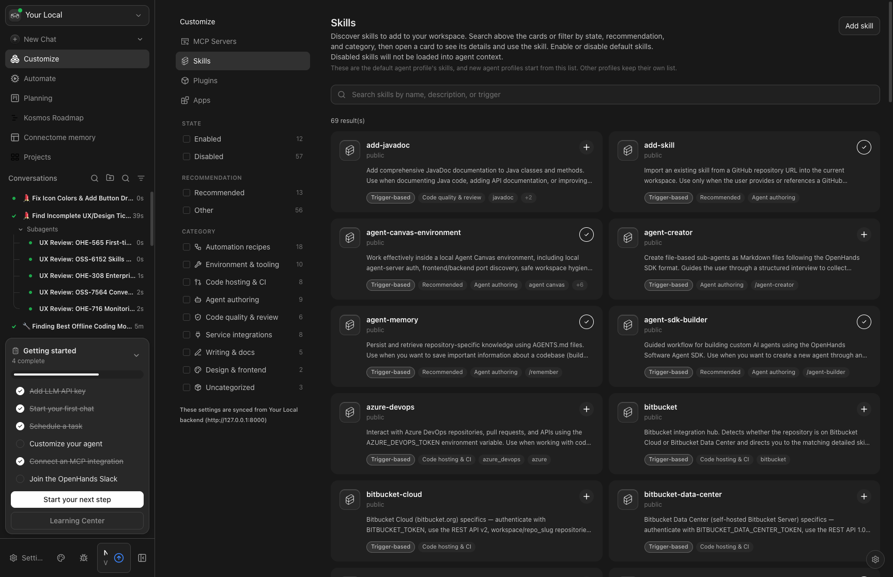
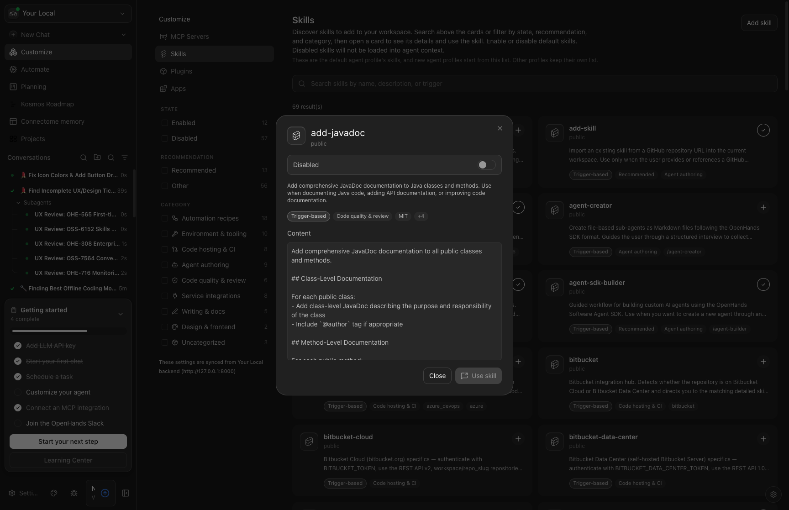

# OSS-6152: Skills Management Redesign Analysis

**Linear Issue:** [OSS-6152 - [Design] Redesign Skills Management](https://linear.app/all-hands-ai/issue/OSS-6152)
**Parent Issue:** [OSS-6151 - [PRD] Re-thinking Skills Management](https://linear.app/all-hands-ai/issue/OSS-6151)
**Status:** In Progress (STALE - Created Jan 2026, last updated Jul 2026)
**Priority:** High
**Labels:** Needs Design

---

## 1. Executive Summary

The current Skills Management UI in Agent Canvas is **well-implemented and feature-complete** for its current scope. After thorough analysis of 18 component files, the codebase reveals a mature, thoughtfully-designed system with:

- Comprehensive filtering and faceting
- Responsive design (desktop/mobile)
- Full CRUD-like functionality (browse, enable/disable, add via chat)
- Clean component architecture
- Extensible data model

**Recommendation:** The "redesign" scope should focus on **new capabilities from the PRD** rather than UI polish. Close OSS-6152 or redefine scope to specific PRD items.

---

## 2. Component Inventory

### 2.1 Core Display Components (6 files)

| Component | File | Purpose | UX Quality |
|-----------|------|---------|------------|
| `SkillCard` | `skill-card.tsx` | Grid card displaying skill name, description, type badge, toggle | ✅ Excellent |
| `SkillDetailModal` | `skill-detail-modal.tsx` | Full skill view with content preview, enable/disable, "Use skill" action | ✅ Excellent |
| `SkillIconBadge` | `skill-icon-badge.tsx` | Consistent skill icon styling | ✅ Good |
| `SkillTypeBadge` | `skill-type-badge.tsx` | Type pill (agentskills/knowledge/repo) | ✅ Good |
| `SkillCardPillRow` | `skill-card-pill-row.tsx` | Overflow-aware pill container with popover | ✅ Excellent |
| `AddSkillModal` | `add-skill-modal.tsx` | Instructions for adding skills via chat command | ⚠️ See notes |

### 2.2 Filtering & Navigation (5 files)

| Component | File | Purpose | UX Quality |
|-----------|------|---------|------------|
| `SkillsToolbar` | `skills-toolbar.tsx` | Search input + mobile filter button | ✅ Good |
| `SkillFacetRail` | `skill-facet-rail.tsx` | Desktop sidebar with filter groups | ✅ Excellent |
| `SkillFacetRow` | `skill-facet-row.tsx` | Individual checkbox filter row with count | ✅ Good |
| `SkillFiltersModal` | `skill-filters-modal.tsx` | Mobile filter modal wrapping FacetRail | ✅ Good |
| `ExtensionsNavigation` | `extensions-navigation.tsx` | Sidebar nav (MCP/Skills/Plugins/Apps) | ✅ Good |

### 2.3 Utility/Logic Files (7 files)

| File | Purpose |
|------|---------|
| `skill-filter.ts` | ~400 LOC filter state machine, URL sync, facet computation |
| `build-skill-pills.tsx` | Generates pill metadata from skill properties |
| `get-skill-card-description.ts` | Extracts description from frontmatter/content |
| `get-skill-chat-launch-message.ts` | Builds `/skill-name` chat command |
| `is-copyable-skill-source.ts` | Determines if source path is copyable |
| `extensions-mobile-hub.tsx` | Mobile landing for Customize section |

### 2.4 Page Component

| Component | File | Purpose |
|-----------|------|---------|
| `SkillsSettingsScreen` | `src/routes/skills-settings.tsx` | Full page orchestrating all components |

**Total: 18 component/utility files** comprising a mature Skills UI subsystem.

---

## 3. Current User Flows

### 3.1 Browse Skills
```
/skills → Grid of SkillCards → Click card → SkillDetailModal
```
- ✅ Search by name, description, trigger
- ✅ Filter by State (enabled/disabled)
- ✅ Filter by Recommendation
- ✅ Filter by Source (project/personal/public)
- ✅ Filter by Category (9 categories)
- ✅ URL-synced filters for shareability
- ✅ Result count display
- ✅ Clear filters action

### 3.2 Enable/Disable Skills
```
SkillCard toggle → Instant enable/disable
SkillDetailModal toggle → Same behavior
```
- ✅ Works for both local (agent profiles) and cloud backends
- ✅ Proper loading states

### 3.3 View Skill Details
```
Click SkillCard → Modal with:
  - Name, source, description
  - Enable/disable toggle
  - Type/category/version pills
  - Full content preview (readonly)
  - "Use skill" button → Launches chat with /skill-name
```

### 3.4 Add Skills
```
Click "Add skill" → AddSkillModal → Copy example command → Use in chat
```
- ⚠️ **Indirect flow** - user must paste command in conversation
- No in-UI skill import/creation

---

## 4. Screenshots

### Skills Page (Desktop)


### Skill Detail Modal


---

## 5. Comparison with PRD Requirements (OSS-6151)

### MVP Requirements from PRD

| PRD Item | Current Status | Gap |
|----------|---------------|-----|
| Browse Skills from Personal Repo | ⚠️ Partial - Shows enabled skills, not personal repo view | Missing personal repo grouping |
| Launch Conversation with Skill | ✅ Implemented - "Use skill" button | Working |
| Save Skill to Personal Repo | ❌ Not implemented | Major gap |

### Later Requirements from PRD

| PRD Item | Current Status | Gap |
|----------|---------------|-----|
| Enable/disable Skills within Conversation | ✅ Settings page works | Could add in-conversation toggle |
| Repo Context Management (AGENTS.md) | ❌ Not in Skills UI | Major gap - separate feature |
| Trigger-based Skills in Conversation | ❌ Not implemented | Slash command infrastructure needed |
| Importing Skills (one-off) | ❌ Not implemented | AddSkillModal is guidance only |
| Skill Builder workflow | ❌ Not implemented | Major feature |
| Publish Skills as Plugins | ❌ Not implemented | Roadmap item |
| CLI↔Cloud sync | ❌ Not implemented | Infrastructure needed |

---

## 6. UX Issues & Rough Edges

### 6.1 Minor Issues (Polish)

1. **AddSkillModal is guidance-only**: The "Add skill" button opens instructions, not an import wizard. Users must copy a command and use it in chat.

2. **No visual grouping by source**: Skills from different sources (project, personal, public) are mixed in the grid. Filters work, but default view doesn't surface organization.

3. **Content preview is read-only**: Users can see skill content but can't edit it. This is intentional but could confuse users expecting to customize.

4. **No skill search history**: Filter state syncs to URL but there's no saved/recent searches.

### 6.2 Medium Issues (Functionality)

1. **No direct skill import**: Despite the PRD's `/save-skill` vision, adding skills requires manual conversation interaction.

2. **No personal repo integration**: The PRD envisions `username/.openhands/skills` as a personal skill storage location - not surfaced in UI.

3. **Cloud backend limitations**: For Cloud backends, Skills link redirects to cloud settings page (external), breaking the in-app flow.

### 6.3 Non-Issues (Working Well)

- Responsive design (mobile/desktop)
- Filter performance with 69+ skills
- URL state management
- Enable/disable persistence
- Skill detail richness
- Component architecture

---

## 7. Architecture Quality Assessment

### Strengths

1. **Clean separation of concerns**: Display, filtering, and data logic are well-separated
2. **Type safety**: Full TypeScript coverage with explicit SkillInfo type
3. **Reusable patterns**: Facet system could extend to other entity types
4. **URL-driven state**: Filter state is bookmarkable and shareable
5. **Responsive design**: Desktop rail + mobile modal pattern

### Areas for Improvement

1. **No unit tests**: `tests/unit/components/features/skills/` doesn't exist
2. **E2E tests exist**: `tests/e2e/mock-llm/skills/` covers basic flows
3. **Missing hooks**: No `useSkillImport` or `useSkillCreate` hooks

---

## 8. Recommendation

### Option A: Close OSS-6152 as "No Action Needed" ⭐ Recommended

The current Skills UI is well-implemented. The "redesign" is actually **new feature development** per the PRD. Recommend:

1. **Close OSS-6152** - UI design is adequate
2. **Create specific feature issues** for:
   - OSS-XXXX: Add `/save-skill` slash command
   - OSS-XXXX: Personal repo skill management
   - OSS-XXXX: In-conversation skill toggle
   - OSS-XXXX: Skill Builder workflow

### Option B: Redefine Scope

If the issue must remain open, redefine as:
> "Skills Management V2: Personal Repo & Import"

Focus on:
1. Personal repo (`~/.openhands/skills`) visibility
2. Direct import wizard (not chat-based)
3. Skill categorization by origin

### Option C: UX Polish Sprint

If incremental improvement is desired:
1. Group skills by source in default view
2. Add "recently enabled" section
3. Convert AddSkillModal to import wizard
4. Add skill preview before import

---

## 9. Files Analyzed

```
src/components/features/skills/
├── add-skill-modal.tsx           (167 lines)
├── build-skill-pills.tsx         (141 lines)
├── extensions-mobile-hub.tsx     (71 lines)
├── extensions-navigation.tsx     (145 lines)
├── get-skill-card-description.ts (52 lines)
├── get-skill-chat-launch-message.ts (13 lines)
├── is-copyable-skill-source.ts   (22 lines)
├── skill-card-pill-row.tsx       (212 lines)
├── skill-card.tsx                (123 lines)
├── skill-detail-modal.tsx        (202 lines)
├── skill-facet-rail.tsx          (61 lines)
├── skill-facet-row.tsx           (65 lines)
├── skill-filter.ts               (291 lines)
├── skill-filters-modal.tsx       (55 lines)
├── skill-icon-badge.tsx          (26 lines)
├── skill-type-badge.tsx          (35 lines)
└── skills-toolbar.tsx            (70 lines)

src/routes/
└── skills-settings.tsx           (206 lines)

Total: ~1,957 lines of Skills UI code
```

---

## 10. Conclusion

OSS-6152 "[Design] Redesign Skills Management" is stale because **no redesign is needed**. The current implementation is solid. The parent PRD (OSS-6151) describes new capabilities, not UI redesign.

**Action Items:**
1. Review this analysis with the team
2. Decide on Option A (close) or Option B (redefine)
3. If Option B, create discrete feature tickets
4. Update Linear issue status

---

*Analysis performed: October 2026*
*Branch: `ux-review/oss-6152-skills-redesign`*
