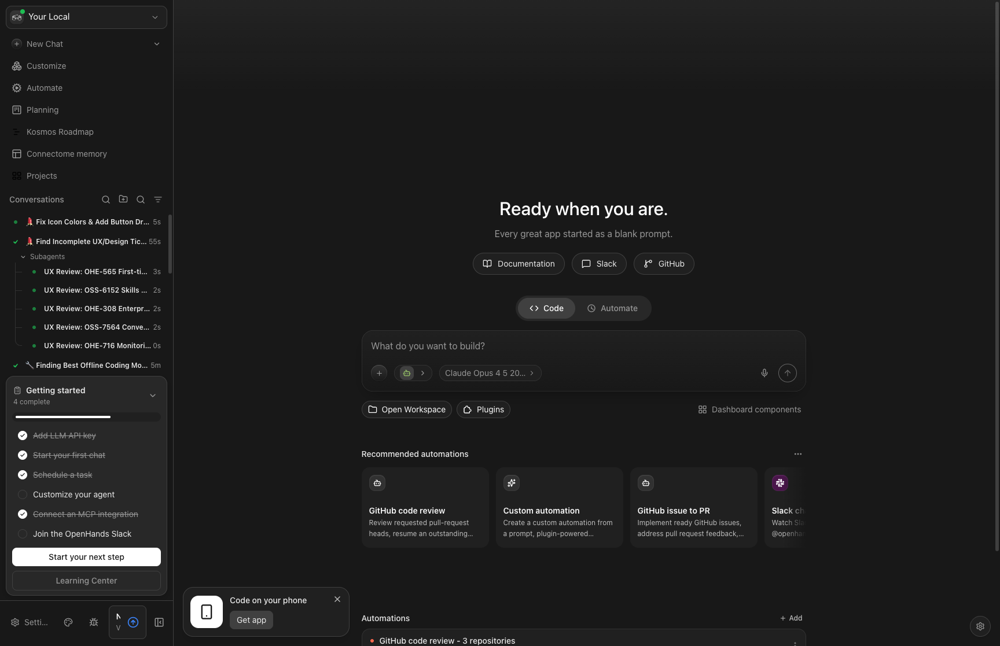

# OSS-7564: Conversation Dashboard Design Analysis

**Issue:** [OSS-7564 - [Design] Conversation Dashboard](https://linear.app/all-hands-ai/issue/OSS-7564/design-conversation-dashboard)  
**Status:** In Progress (STALE - ~3 months since July 2026)  
**Priority:** High  
**Figma:** [Design Link](https://www.figma.com/design/iM5UBG1lnpg2sgE3cFnF1P/OpenHands?node-id=12406-22822) *(403 - Not publicly accessible)*  
**Analysis Date:** 2026-10-24  
**Branch:** `ux-review/oss-7564-conversation-dashboard`

---

## Executive Summary

The Conversation Dashboard design (OSS-7564) cannot be fully audited because the Figma design file returns a 403 error. However, based on code examination, the current implementation has evolved significantly with extensive conversation management features. **Without the original design spec visible, we cannot determine if the implementation aligns with or deviates from the intended design.**

### Key Finding
**The Figma design is inaccessible (403 Forbidden)**, making it impossible to perform a definitive gap analysis. This analysis instead documents the current implementation state and recent related work.

---

## Current Implementation Overview

### 1. Home Dashboard Architecture

The home dashboard (`home-dashboard-widgets.tsx`) provides a widget-based architecture with 10 registered widgets:

| Widget ID | Label Key | Placement | Default Visible | Status |
|-----------|-----------|-----------|-----------------|--------|
| `learnResources` | Learning Resources | header | ✓ | Renders null (placeholder) |
| `recommendedAutomations` | Recommended Automations | body | ✓ | Active - dismissible automation suggestions |
| `pinnedAutomations` | Pinned Automations | body | ✓ | Active - starred automation cards |
| `runningAutomations` | Running Automations | body | ✓ | Active - live automation status |
| `agentCanvasVersion` | Agent Canvas Version | body | ✗ | Lazy loaded version tile |
| `agentCanvasUpdate` | Agent Canvas Update | body | ✗ | Lazy loaded update card |
| `onboardingChecklist` | Onboarding Checklist | body | ✗ | Lazy loaded checklist |
| `recentConversations` | Recent Conversations | body | ✗ | Lazy loaded `ConversationPanel` |
| `kanbanBoard` | Kanban Board | body | ✗ | Lazy loaded kanban view |
| `planningBoard` | Planning Board | body | ✗ | Lazy loaded planning board |

**Notable:** The `recentConversations` widget wraps `ConversationPanel` in a `BoundedWidget` (h-96, 384px height, scrollable).

### 2. Conversation Panel Features

The `ConversationPanel` component (`conversation-panel.tsx`) is a comprehensive conversation management UI with:

#### Display Modes
- **Compact mode:** Icon-only status dots with hover previews (for collapsed sidebar)
- **Full mode:** Full conversation cards with metadata

#### Organization Features
- **Organize modes:** `chronological`, `grouped` (by workspace/project)
- **Sort options:** `updated` or `created` timestamp
- **Thread scopes:** `all`, `top-level`, `subagents`
- **Automation filters:** `all`, `only-automations`, `no-automations`

#### Conversation Card Metadata
- Title with inline edit
- Execution status (running/stopped/error)
- Sandbox status indicators
- Git diff stats (+/- line counts)
- Repository/branch metadata
- LLM profile badges
- Tag chips (user-defined tags)
- Timestamp (relative time)
- Archive status

#### Actions
- Delete conversation
- Archive/unarchive
- Stop running conversation
- Edit title
- Edit tags
- Download conversation
- Open in VS Code
- Pin/unpin conversations
- Context menu with full action set

#### Advanced Features
- Subagent tree view with collapsible children
- Drag-to-reorder conversations and groups
- Pagination with "Load more"
- Search via command menu integration
- Tag facet filtering
- Pinned conversations section
- Group folder organization

### 3. Related Recent Work

Based on git history, significant dashboard-related commits:

| Commit | Feature |
|--------|---------|
| `7ae2cc54` | `feat(types): add unified ProjectItem types for multi-source dashboard` - Types for GitHub/Linear/Notion issue aggregation |
| `420f365e` | `feat(feed): add Facebook-style conversation feed` |
| `74eb1461` | `feat(home): add a dashboard widget registry with six new widgets` |
| `ae8b9df7` | `feat(home): shared drag-reorder library for dashboard components` |
| `a2701adb` | `fix(home): move dashboard components button into the composer action row` |
| `51967375` | `feat(home,sidebar): merge in-progress dashboard HUD, backend menu, and appearance work` |
| `4ef0b3f4` | `feat(conversation): add activity summary and commit action` |

### 4. ProjectItem Types (Recent Addition)

New unified types for multi-source dashboard aggregation (`src/types/project-item.ts` - in recent commit):

```typescript
// Unified issue type from GitHub, Linear, Notion
export interface ProjectItem {
  id: string;
  source: "github" | "linear" | "notion" | "local";
  title: string;
  status: "backlog" | "todo" | "in_progress" | "review" | "done" | "cancelled";
  priority: "urgent" | "high" | "medium" | "low" | "none";
  labels: ProjectItemLabel[];
  assignees: ProjectItemAssignee[];
  linkedConversationId?: string; // Links to OpenHands conversations
  // ... additional fields
}

// 8 default filter views: My Work, @Mentioned, Product, Needs Design, Bugs, Urgent, In Progress, Due Soon
```

### 5. Kanban & Planning Components

- **KanbanBoard:** Simple 3-column board (Todo, In Progress, Done) with drag-drop
- **PlanningBoard:** Multi-view planning tool with Kanban, Gantt, Sprint views

---

## Current UI Screenshots

### Home Dashboard (Current State)


**Observed Components:**
1. Left sidebar with conversation list
2. Main area with "Ready when you are" prompt
3. Quick action buttons (Code, Automate)
4. Composer input at center
5. Recommended automations cards
6. Pinned automations section
7. Getting Started onboarding checklist

### Sidebar Conversation List



**Observed Features:**
1. Conversation list with status dots (green = active)
2. Subagent tree with expandable children
3. Title truncation with timestamps
4. "Load more" pagination
5. Search and filter icons in header

---

## Gap Analysis (Limited)

### What We CAN Assess (Implementation Quality)

| Feature | Implementation | Quality |
|---------|----------------|---------|
| Conversation list | ✓ Full | Extensive filtering, sorting, grouping |
| Conversation cards | ✓ Full | Rich metadata, actions, status indicators |
| Dashboard widgets | ✓ Partial | Widget registry exists, 4 active by default |
| Kanban view | ✓ Basic | 3-column board, drag-drop works |
| Planning board | ✓ Present | Multi-view with Gantt, Sprint views |
| Recent conversations widget | ✓ Present | Bounded 384px height, lazy loaded |
| Multi-source aggregation | ✓ Types only | ProjectItem types added, no UI yet |

### What We CANNOT Assess (No Design Access)

- Visual design alignment (colors, spacing, typography)
- Component layout/positioning vs. Figma
- Missing UI elements that should exist per design
- Interaction patterns (hover states, animations)
- Mobile/responsive breakpoints
- Empty states and error states
- Design system compliance

---

## Estimated Implementation Status

Based on component existence and feature completeness:

| Category | Estimate |
|----------|----------|
| **Core conversation list** | ~90% complete |
| **Conversation card design** | ~85% complete |
| **Dashboard widget system** | ~70% complete |
| **Multi-source aggregation (ProjectItem)** | ~10% (types only) |
| **Overall vs. unknown design** | **Cannot determine** |

---

## Effort Estimates (If Design Were Available)

### Likely Remaining Work Categories

| Work Area | Effort | Notes |
|-----------|--------|-------|
| Design alignment review | 2-4 hours | Once Figma accessible |
| Visual polish/spacing fixes | 4-8 hours | Typical design-to-code deltas |
| Missing UI elements | 8-24 hours | Depends on gap size |
| ProjectItem dashboard view | 16-40 hours | Full multi-source dashboard UI |
| Integration testing | 4-8 hours | End-to-end flows |

---

## Recommendations

### Immediate Actions

1. **Restore Figma Access** - The 403 error blocks all design comparison. Contact design team to:
   - Make link public/accessible
   - Export static design images
   - Provide design spec document

2. **Update Issue Status** - Mark OSS-7564 as blocked on design access.

3. **Clarify Scope** - Determine if "Conversation Dashboard" means:
   - The sidebar conversation list (largely complete)
   - A dedicated dashboard page (partially exists as home widgets)
   - The multi-source ProjectItem dashboard (types exist, no UI)

### Scope Decision Options

| Option | Recommendation | Rationale |
|--------|----------------|-----------|
| **Close as "Largely Done"** | If design only covered conversation list | Current implementation is feature-rich |
| **Continue with Revised Scope** | If design covers ProjectItem dashboard | Focus remaining effort there |
| **Pause Until Design Accessible** | Recommended | Cannot verify completion without spec |

---

## Files Examined

### Primary Components
- `src/components/features/home/home-dashboard-widgets.tsx`
- `src/components/features/conversation-panel/conversation-panel.tsx`
- `src/components/features/conversation-panel/conversation-card/conversation-card.tsx`
- `src/components/features/sidebar/sidebar-conversation-list.tsx`
- `src/components/features/kanban/kanban-board.tsx`
- `src/components/features/planning/planning-board.tsx`

### Stores
- `src/stores/conversation-panel-preferences-store.ts`
- `src/stores/conversation-diff-stats-store.ts`
- `src/stores/pinned-conversations-store.ts`
- `src/stores/archived-conversations-store.ts`

### Types
- `src/types/project-item.ts` (recent addition via `7ae2cc54`)

---

## Conclusion

**Cannot determine percentage of design implemented** due to Figma access issues (403 error).

The current conversation management UI is **feature-complete and mature**, with:
- Rich conversation cards with extensive metadata
- Multiple organization modes (chronological, grouped)
- Advanced filtering (tags, automations, thread scope)
- Drag-reorder support
- Subagent tree views
- Pinning system
- Archive/delete workflows

**Recommendation:** Pause this ticket until the Figma design is accessible. If the design was solely for the conversation list/panel, this may be **largely complete**. If it covers a multi-source dashboard aggregating GitHub/Linear/Notion issues, that work is at **types-only stage (~10%)**.

---

*Analysis prepared by OpenHands agent on behalf of the development team.*
